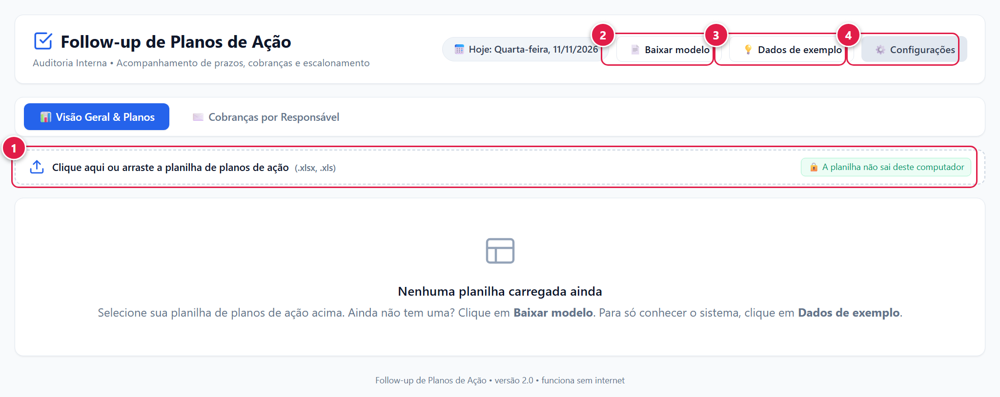
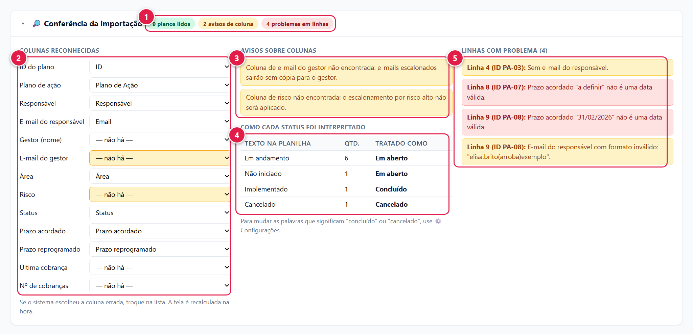
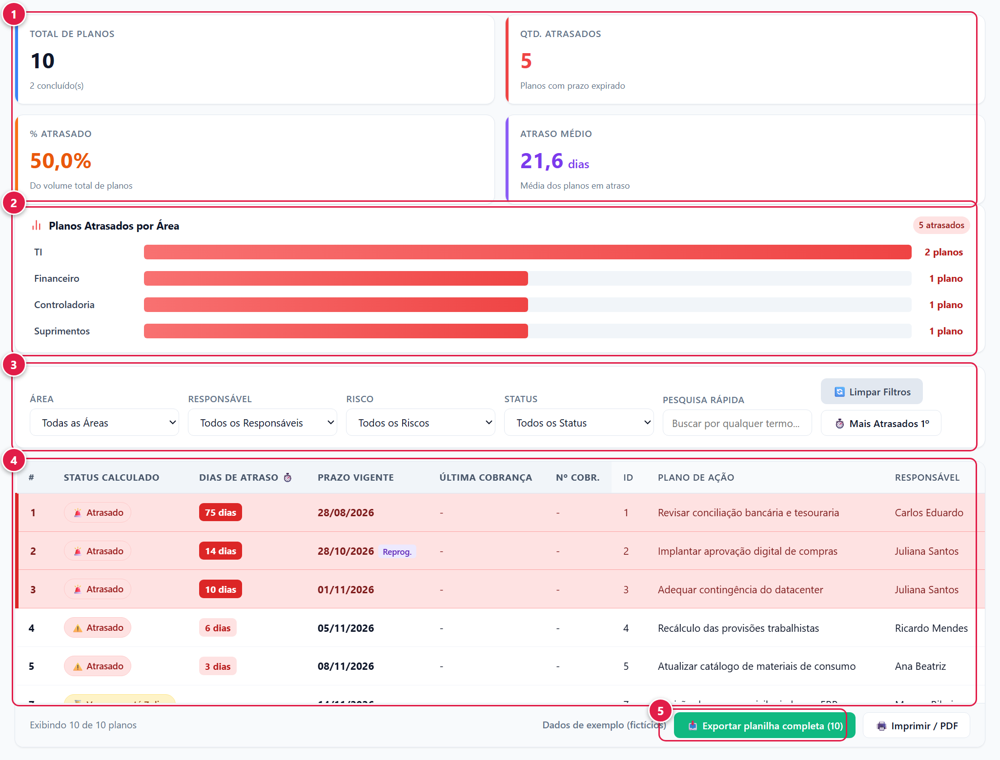
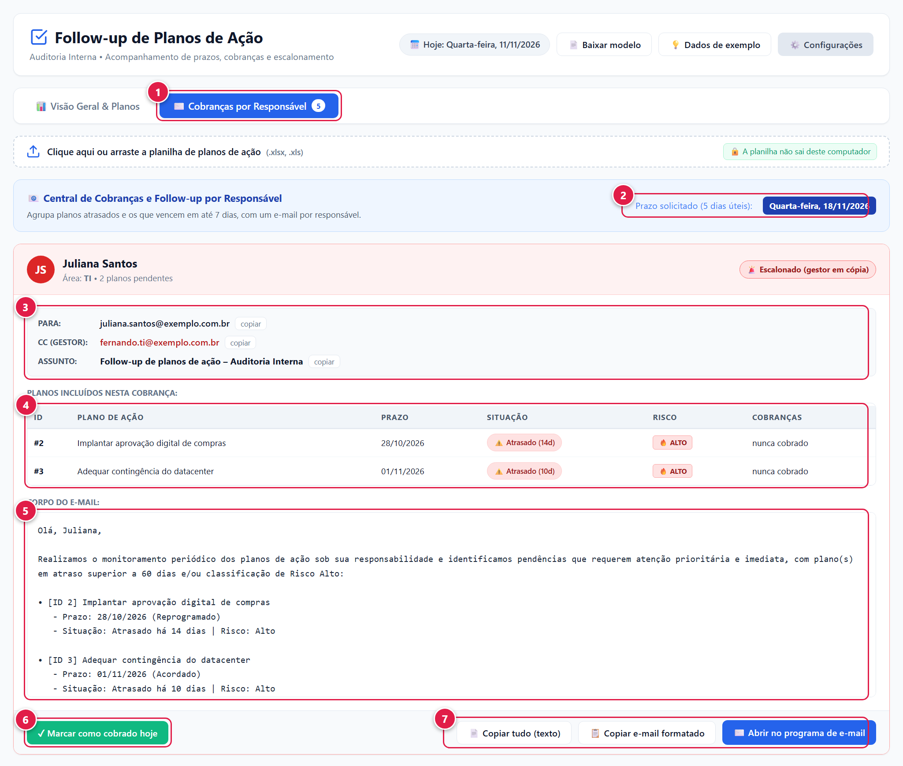
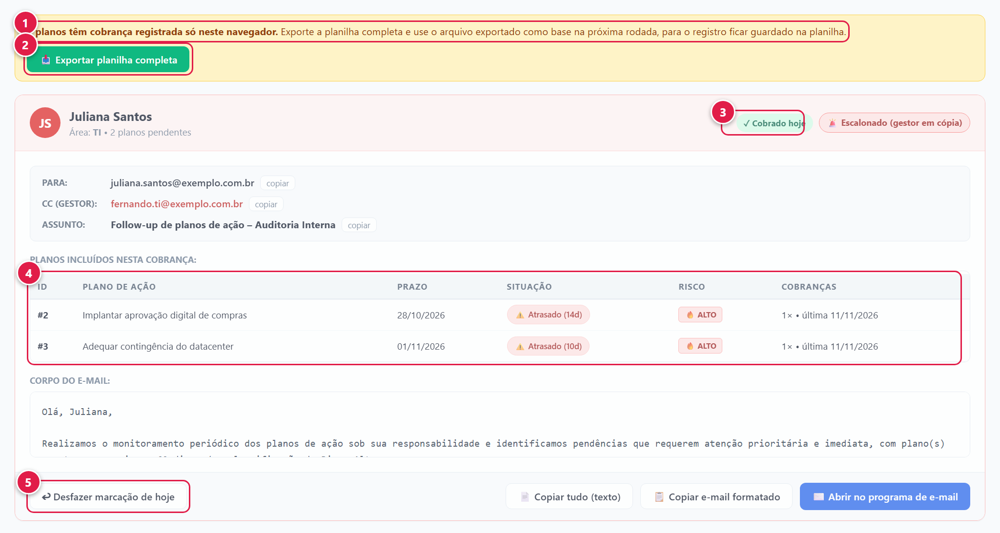
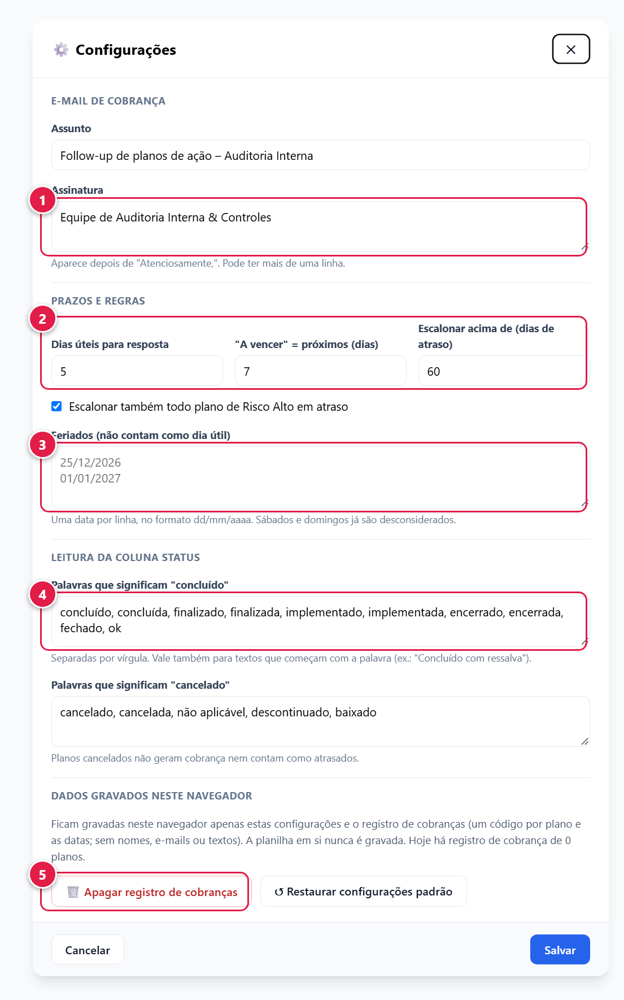
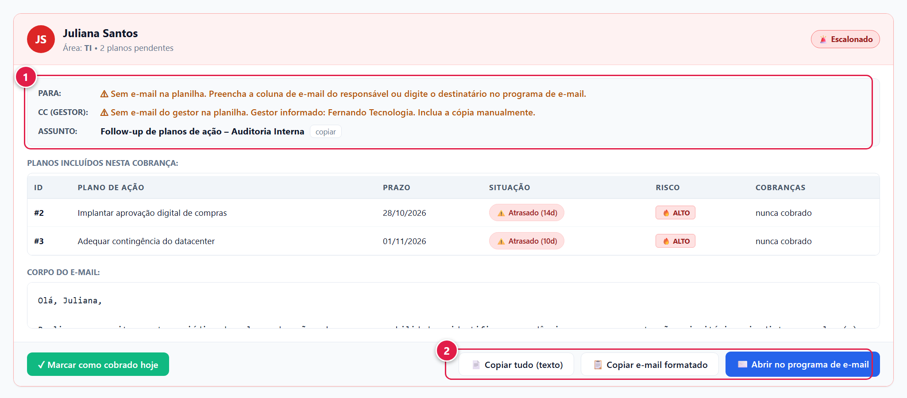

# Manual de instalação e uso

**Follow-up de Planos de Ação — versão 2.0**

Este manual é para quem vai instalar o sistema do zero e usá-lo no dia a dia. Não é preciso saber programar.

## Sumário

1. [O que é o sistema](#1-o-que-é-o-sistema)
2. [Instalação manual (baixar o ZIP)](#2-instalação-manual-baixar-o-zip)
3. [Instalação com ferramentas de IA](#3-instalação-com-ferramentas-de-ia)
4. [Preparar a planilha](#4-preparar-a-planilha)
5. [Uso no dia a dia](#5-uso-no-dia-a-dia)
6. [Configurações](#6-configurações)
7. [Problemas comuns](#7-problemas-comuns)
8. [Dados e privacidade](#8-dados-e-privacidade)
9. [Atualizar para uma versão nova](#9-atualizar-para-uma-versão-nova)

## 1. O que é o sistema

O sistema lê a sua planilha de planos de ação e faz quatro coisas:

- calcula quais planos estão atrasados, a vencer, no prazo ou sem prazo;
- mostra indicadores e os atrasos por área;
- monta um e-mail de cobrança por responsável, com tom cordial ou escalonado;
- registra quem já foi cobrado e quando.

### O que você precisa

- Um computador com Windows, macOS ou Linux.
- Um navegador atualizado: Google Chrome ou Microsoft Edge.
- A sua planilha de planos de ação em Excel (`.xlsx` ou `.xls`). Se ainda não tem, o sistema gera um modelo.

### O que você não precisa

- Instalar programas.
- Ter internet para usar (só para baixar o sistema).
- Criar conta ou senha.

## 2. Instalação manual (baixar o ZIP)

Use este caminho se você não usa ferramentas de programação. Leva cerca de dois minutos.

### Passo 1 — Abra a página do projeto

Abra no navegador o endereço do projeto no GitHub:

```text
https://github.com/jeffersoncp21/follow-up-planos-de-acao
```

### Passo 2 — Baixe o ZIP

Na página do projeto, clique no botão verde **Code** e depois em **Download ZIP**.

O navegador salva um arquivo `.zip` na pasta Downloads.

### Passo 3 — Extraia o ZIP

No Windows, clique com o botão direito no arquivo `.zip` e escolha **Extrair tudo**. Confirme em **Extrair**.

No macOS, dê dois cliques no arquivo `.zip`.

> **Atenção — este é o erro mais comum:** não abra o `index.html` de dentro do ZIP. O Windows deixa você "entrar" no ZIP sem extrair, mas o sistema não funciona assim: aparece uma faixa vermelha dizendo que o leitor de Excel não foi carregado. Extraia primeiro.

### Passo 4 — Guarde a pasta em um lugar definitivo

Mova a pasta extraída para onde você guarda suas ferramentas, por exemplo `Documentos`.

> **Atenção:** mantenha a pasta inteira. O arquivo `index.html` precisa das pastas `js` e `vendor` ao lado dele. Copiar só o `index.html` não funciona.

Dentro da pasta você deve ver, entre outros arquivos:

```text
index.html
js
vendor
docs
```

### Passo 5 — Abra o sistema

Dê dois cliques em `index.html`. Ele abre no navegador.

Se abrir em outro programa, clique com o botão direito em `index.html`, escolha **Abrir com** e selecione o Chrome ou o Edge.

### Passo 6 — Confira se está funcionando

Você deve ver a tela inicial abaixo, sem nenhuma faixa vermelha.



1. Faixa para carregar a sua planilha (clique ou arraste o arquivo).
2. **Baixar modelo:** gera uma planilha com as colunas certas.
3. **Dados de exemplo:** carrega planos fictícios para você conhecer o sistema.
4. **Configurações:** assinatura, prazos, feriados e regras.

Clique em **Dados de exemplo**. Se aparecerem os indicadores e a tabela, a instalação está certa.

### Passo 7 — Crie um atalho (opcional)

No Windows, clique com o botão direito em `index.html`, escolha **Enviar para** e depois **Área de trabalho (criar atalho)**.

Você também pode salvar a página nos favoritos do navegador.

## 3. Instalação com ferramentas de IA

Use este caminho se você já trabalha com uma ferramenta de IA que executa comandos no seu computador, como Claude Code, Gemini CLI, Codex ou Antigravity. A ferramenta baixa, confere e abre o sistema para você.

### Passo 1 — Abra a ferramenta na pasta certa

Abra o terminal na pasta onde você quer guardar o sistema (por exemplo, `Documentos`) e inicie a ferramenta.

Claude Code:

```bash
claude
```

Gemini CLI:

```bash
gemini
```

Codex:

```bash
codex
```

No Antigravity, abra a pasta desejada no programa e use o painel do agente.

### Passo 2 — Cole o pedido pronto

Copie o texto abaixo e cole na ferramenta.

```text
Instale para mim o sistema "Follow-up de Planos de Ação" a partir deste repositório:
https://github.com/jeffersoncp21/follow-up-planos-de-acao

Faça assim:
1. Baixe o repositório para uma pasta nova chamada "follow-up-planos-de-acao" dentro da pasta atual
   (use git clone; se não houver git, baixe o ZIP do GitHub e extraia).
2. Confirme que existem os arquivos index.html, js/logica.js, js/app.js e vendor/xlsx.full.min.js.
   Se faltar algum, pare e me avise.
3. Se o Node.js estiver instalado, rode "node --test" dentro da pasta e me diga o resultado.
   Se não estiver, pule esta etapa e me avise. Não instale nada sem me perguntar.
4. Abra o index.html no meu navegador padrão.
5. Ao final, me diga em linguagem simples: em que pasta ficou, se os testes passaram
   e como eu abro o sistema da próxima vez.

Regras: não apague nem altere nenhum arquivo meu fora dessa pasta nova, não instale programas
sem me perguntar e não envie nenhum dado meu para a internet.
```

### Passo 3 — Acompanhe e autorize

A ferramenta vai pedir autorização para executar comandos. Leia cada pedido antes de aceitar. Os comandos esperados são de baixar o repositório, listar arquivos, rodar os testes e abrir o navegador.

> **Atenção:** o sistema não precisa de nenhuma instalação. Se a ferramenta sugerir instalar pacotes ou subir um servidor, recuse. Basta abrir o `index.html`.

### Alternativa — só com Git

Se você tem o Git instalado e prefere fazer à mão, baixe o repositório:

```bash
git clone https://github.com/jeffersoncp21/follow-up-planos-de-acao follow-up-planos-de-acao
```

Depois abra o arquivo `index.html` que está dentro da pasta `follow-up-planos-de-acao`.

## 4. Preparar a planilha

### Passo 1 — Baixe o modelo

Na tela inicial, clique em **Baixar modelo**. O navegador salva o arquivo `modelo_planos_de_acao.xlsx`.

O modelo tem duas linhas de exemplo e uma aba "Instruções". Apague as linhas de exemplo antes de usar.

### Passo 2 — Preencha as colunas

Use uma linha por plano de ação. O cabeçalho fica na linha 1.

| Coluna | O que colocar | Se faltar |
|---|---|---|
| ID | Código do plano | O sistema numera sozinho |
| Plano de Ação | Texto do plano | Aparece "Plano de ação #n" |
| Responsável | Nome de quem responde pelo plano | Não há como agrupar as cobranças |
| Email | E-mail do responsável | A cobrança sai sem destinatário |
| Gestor | Nome do gestor | Nada muda |
| Email do Gestor | E-mail do gestor | O e-mail escalonado sai sem cópia |
| Área | Área responsável | Aparece "Não informada" |
| Risco | Alto, Médio ou Baixo | Não há escalonamento por risco |
| Status | Situação do plano | Todos contam como em aberto |
| Prazo acordado | Data no formato dd/mm/aaaa | Não há cálculo de atraso |
| Prazo reprogramado | Nova data, se houver | Vale o prazo acordado |
| Última cobrança | Deixe em branco | O sistema preenche |
| Nº de cobranças | Deixe em branco | O sistema preenche |

Você pode ter outras colunas. Elas aparecem na tela e são mantidas na exportação.

> **Atenção:** o sistema nunca inventa endereços de e-mail. Se a coluna Email estiver vazia, o cartão de cobrança avisa e a mensagem sai sem destinatário.

### Passo 3 — Use os nomes de status que o sistema entende

- **Concluído:** "Concluído", "Finalizado", "Implementado", "Encerrado", "Fechado" ou "OK". Também vale texto que começa com essas palavras, como "Concluído com ressalva".
- **Cancelado:** "Cancelado", "Não aplicável", "Descontinuado" ou "Baixado".
- **Em aberto:** qualquer outro texto, como "Em andamento" ou "Não iniciado".

Se a sua empresa usa outras palavras, cadastre-as nas Configurações (parte 6).

### Já tem uma planilha própria?

Pode usar. Os nomes das colunas não precisam ser idênticos aos do modelo. O sistema reconhece variações comuns, como "Situação" no lugar de "Status" ou "Setor" no lugar de "Área". O que ele não reconhecer, você aponta na conferência da importação.

## 5. Uso no dia a dia

A rotina tem sete passos: carregar, conferir, analisar, abrir as cobranças, enviar, marcar e exportar.

### Passo 1 — Carregue a planilha

Clique na faixa "Clique aqui ou arraste a planilha" e escolha o arquivo. Também dá para arrastar o arquivo para a faixa.

Se o arquivo tiver várias abas, o sistema escolhe a que mais se parece com uma lista de planos. Você pode trocar no passo seguinte.

### Passo 2 — Confira a importação

O painel **Conferência da importação** abre sozinho quando há algo a revisar.



1. Resumo: quantos planos foram lidos, quantos avisos e quantos problemas.
2. Colunas reconhecidas. Em amarelo, as que não foram encontradas. Se o sistema escolheu a coluna errada, troque na lista.
3. Avisos sobre colunas que fazem falta e o efeito de cada uma.
4. Como cada texto da coluna Status foi interpretado.
5. Linhas com problema, com o número da linha na planilha.

> **Atenção:** corrija os problemas na planilha e carregue de novo. Um plano com prazo inválido fica como "Sem prazo" e não gera cobrança.

### Passo 3 — Analise a visão geral



1. Indicadores: total de planos, atrasados, percentual e atraso médio.
2. Planos atrasados por área. Clique em uma barra para filtrar a tabela por aquela área.
3. Filtros por área, responsável, risco e status, mais a pesquisa por qualquer termo.
4. Tabela de planos. As primeiras colunas são calculadas pelo sistema. Clique no título de uma coluna para ordenar. Linhas em vermelho são planos de risco alto em atraso.
5. **Exportar planilha completa.** Quando há filtro aplicado, aparece também o botão "Exportar só o filtro".

### Passo 4 — Abra as cobranças

Clique na aba **Cobranças por Responsável**. Há um cartão por pessoa, com os planos atrasados e os que vencem nos próximos dias.



1. Aba de cobranças. O número mostra quantas pessoas ainda faltam cobrar hoje.
2. Data limite que o e-mail pede para a resposta (5 dias úteis, por padrão).
3. Destinatário, cópia para o gestor (só em e-mails escalonados) e assunto. Cada um tem um botão "copiar".
4. Planos incluídos nesta cobrança e o histórico de cobranças de cada um.
5. Texto do e-mail.
6. **Marcar como cobrado hoje.**
7. Botões para copiar ou abrir o e-mail.

### Passo 5 — Envie o e-mail

Escolha um dos caminhos:

- **Copiar e-mail formatado:** copia a mensagem com a tabela de planos. Abra uma nova mensagem no Outlook ou no Gmail e cole com `Ctrl+V`. Use os botões "copiar" para o destinatário e o assunto.
- **Abrir no programa de e-mail:** abre uma mensagem nova já com destinatário, cópia, assunto e texto simples.
- **Copiar tudo (texto):** copia destinatário, assunto e mensagem em texto simples.

> **Atenção:** quando a mensagem é longa (muitos planos para a mesma pessoa), o botão "Abrir no programa de e-mail" abre só com destinatário e assunto. O texto fica copiado: clique no corpo da mensagem e cole com `Ctrl+V`.

O sistema não envia e-mails. Quem envia é você, pelo seu programa de e-mail.

### Passo 6 — Marque como cobrado

Depois de enviar, clique em **Marcar como cobrado hoje** no cartão.



1. Aviso: há cobranças registradas só neste navegador.
2. Atalho para exportar a planilha completa.
3. Etiqueta "Cobrado hoje". O cartão vai para o fim da lista.
4. Histórico por plano: quantidade de cobranças e data da última.
5. **Desfazer marcação de hoje**, se você marcou por engano.

### Passo 7 — Exporte a planilha completa

Clique em **Exportar planilha completa**. O navegador salva o arquivo `follow_up_AAAA-MM-DD.xlsx`.

O arquivo tem as suas colunas, as colunas "Última cobrança" e "Nº de cobranças" e as colunas calculadas (status, dias de atraso, prazo vigente). Uma segunda aba, "Parâmetros", registra a data-base e as regras usadas.

> **Atenção:** na próxima rodada, carregue este arquivo exportado, não a planilha antiga. É assim que o histórico de cobranças fica guardado na planilha e não depende do navegador.

## 6. Configurações

Clique em **Configurações** no alto da tela.



1. Assinatura que aparece no fim do e-mail. O assunto fica logo acima.
2. Prazos: dias úteis para resposta, janela de "a vencer" e dias de atraso para escalonar.
3. Feriados, um por linha, no formato dd/mm/aaaa. Eles não contam como dia útil.
4. Palavras da coluna Status que significam "concluído" e "cancelado".
5. Apagar o registro de cobranças gravado neste navegador.

Clique em **Salvar**. A tela é recalculada na hora.

### Regras padrão

| Regra | Valor inicial |
|---|---|
| Dias úteis para resposta | 5 |
| "A vencer" | Vence hoje ou nos próximos 7 dias |
| Escalonamento por atraso | Mais de 60 dias |
| Escalonamento por risco | Todo plano de Risco Alto em atraso |

Um e-mail escalonado tem tom mais firme e leva o gestor em cópia, quando há e-mail do gestor na planilha.

## 7. Problemas comuns

### Faixa vermelha: "Não foi possível carregar o leitor de Excel"

O `index.html` foi aberto sem as pastas `js` e `vendor` ao lado. Causas mais comuns: abrir de dentro do ZIP sem extrair, ou copiar só o `index.html`. Extraia o ZIP e mantenha a pasta inteira.

### O cartão mostra "Sem e-mail na planilha"



1. Falta o e-mail do responsável ou do gestor na planilha.
2. Você ainda pode copiar o texto e digitar o destinatário no programa de e-mail.

Para resolver de vez, preencha as colunas Email e Email do Gestor. Se as colunas existem com outro nome, aponte-as na conferência da importação.

### Um plano concluído aparece como atrasado

O texto da coluna Status não está na lista de palavras de conclusão. Veja na conferência como o status foi interpretado e inclua a palavra em Configurações.

### Um plano aparece como "Sem prazo"

A data está vazia ou não é válida, como "a definir" ou "31/02/2026". A conferência mostra a linha. Corrija na planilha usando dd/mm/aaaa.

### O botão "Abrir no programa de e-mail" não faz nada

O computador não tem um programa de e-mail padrão definido. Use **Copiar e-mail formatado** e cole no seu e-mail. No Windows, o programa padrão é definido em Configurações → Aplicativos → Aplicativos padrão.

### O e-mail abriu sem o texto

A mensagem era longa demais para o link. O texto já está copiado: clique no corpo da mensagem e cole com `Ctrl+V`.

### O registro de cobranças sumiu

O registro fica no navegador em que você marcou. Ele não aparece em outro navegador ou computador, e some se você limpar os dados de navegação. Por isso, exporte a planilha completa ao fim de cada rodada e use o arquivo exportado na rodada seguinte.

### O sistema leu a aba errada

Abra a conferência da importação e escolha a aba certa em "Aba da planilha".

### As datas ficaram erradas

O cabeçalho precisa estar na linha 1 e as datas no formato dd/mm/aaaa. Datas no formato americano (mês/dia/ano) não são aceitas.

## 8. Dados e privacidade

### Onde fica cada coisa

| O quê | Onde fica | Por quanto tempo |
|---|---|---|
| A planilha carregada | Na memória do navegador | Até fechar ou recarregar a página |
| Configurações | No armazenamento local do navegador | Até você restaurar o padrão ou limpar os dados do navegador |
| Registro de cobranças | No armazenamento local do navegador | Até você apagar em Configurações ou limpar os dados do navegador |
| Planilha exportada e modelo | Na pasta Downloads | Até você apagar |

O registro de cobranças guarda apenas um código por plano e as datas. Não guarda nomes, e-mails nem textos dos planos.

### O que sai do computador

Nada sai por conta do sistema. Ele não se conecta à internet, não tem servidor e não coleta estatísticas de uso.

Os dados só saem da tela quando você aciona:

- **Copiar:** o texto vai para a área de transferência.
- **Abrir no programa de e-mail:** o texto vai para o seu programa de e-mail.
- **Exportar** e **Baixar modelo:** um arquivo é salvo no seu computador.
- **Imprimir / PDF:** a tela vai para a impressora ou para um arquivo.

### Cuidados que dependem de você

- Se a pasta do sistema ou a sua planilha estiverem dentro do OneDrive, Google Drive ou similar, esses programas sincronizam os arquivos com a nuvem.
- Em computador compartilhado, apague o registro de cobranças ao terminar (Configurações → Apagar registro de cobranças).
- Abra apenas planilhas de origem conhecida.
- Confira destinatário e texto antes de enviar cada e-mail.

## 9. Atualizar para uma versão nova

1. Exporte a planilha completa na versão atual, para levar o histórico de cobranças.
2. Baixe a versão nova pelo mesmo caminho da instalação (parte 2 ou 3).
3. Extraia em uma pasta nova. Não misture os arquivos com os da versão antiga.
4. Abra o `index.html` da pasta nova e carregue a planilha exportada.
5. Confira as Configurações. Se a pasta nova estiver em outro local, o navegador pode tratá-la como um sistema novo e começar com as configurações padrão.

O que mudou em cada versão está em [NOVIDADES.md](../NOVIDADES.md).
